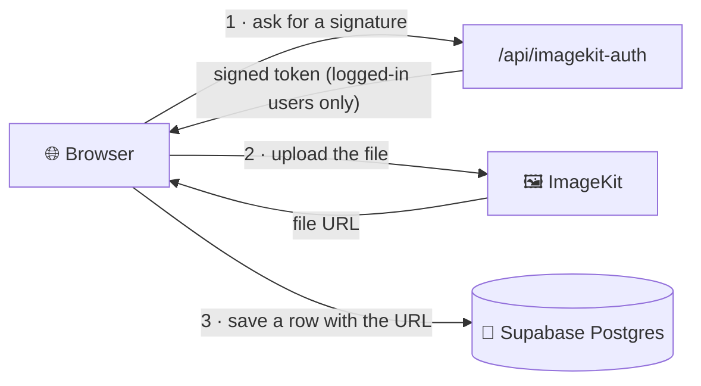

<div align="center">

# 📚 ResourceHub

### Share notes. Ace exams. Do it together.

A playful, student-built platform for sharing study material and campus news.
Upload notes, find what you need, and hear from your SRC and class reps.


**[✨ Features](#-features)** &nbsp;·&nbsp;
**[🚀 Quick start](#-quick-start)** &nbsp;·&nbsp;
**[🧭 How it works](#-how-it-works)** &nbsp;·&nbsp;
**[📁 Project map](#-project-map)** &nbsp;·&nbsp;
**[🧪 Testing](#-testing)**

</div>

---

## ✨ Features

<table>
<tr>
<td width="50%" valign="top">

### 📖 Study resources
- Upload **PDF, Word, text and images** (20MB, plus an optional thumbnail)
- **Search** by title, filter by **subject** and **type**, sort by popularity or date
- One-click **downloads**, counted and shown on every card
- Related resources on each detail page

</td>
<td width="50%" valign="top">

### 📰 Campus blog
- Written by **SRC members and class reps** only
- Title, subtitle, **required cover image**, author, **published** and **updated** dates
- Friendly editor with **toolbar, live preview** and optional **inline images**
- Drafts that only the author can see

</td>
</tr>
<tr>
<td width="50%" valign="top">

### 👤 Accounts
- Sign up with **email**, **Google** or **GitHub**
- Profile page with your uploads and total downloads
- Edit your name, module and bio

</td>
<td width="50%" valign="top">

### 🎨 Fun, responsive design
- **Two themes:** 🌈 *Vibrant* and 🌙 *Dark*, remembered between visits
- Sticky, shrink-on-scroll navbar with a scroll-progress bar
- Works on phones, tablets and desktops
- Respects "reduce motion" settings

</td>
</tr>
</table>

---

## 🚀 Quick start

```bash
npm install
npm run dev        # → http://localhost:3000
```

The app needs a Supabase project and an ImageKit account first. The five steps below take about ten minutes.

<details>
<summary><b>1️⃣ &nbsp;Add your keys</b> &nbsp;<code>.env</code></summary>

<br>

```bash
NEXT_PUBLIC_SUPABASE_URL=
NEXT_PUBLIC_SUPABASE_PUBLISHABLE_KEY=

IMAGEKIT_PUBLIC_KEY=
IMAGEKIT_PRIVATE_KEY=
IMAGEKIT_URL_ENDPOINT=
```

> 🔒 The ImageKit **private** key stays on the server. It is never sent to the browser.

</details>

<details>
<summary><b>2️⃣ &nbsp;Create the database</b> &nbsp;<code>supabase/schema.sql</code></summary>

<br>

In the Supabase dashboard open **SQL Editor → New query**, paste [`supabase/schema.sql`](supabase/schema.sql) and click **Run**.

| Table | What it holds |
| :-- | :-- |
| 🧑 `profiles` | One row per user: name, avatar, module, bio. Created automatically at sign-up. |
| 📄 `resources` | Uploaded study material and its ImageKit file and thumbnail URLs. |
| 📰 `posts` | Blog posts. |

It also switches on **row-level security** and adds the `increment_download` function used by the download counter.

</details>

<details>
<summary><b>3️⃣ &nbsp;Add the blog</b> &nbsp;<code>supabase/blog.sql</code></summary>

<br>

Run [`supabase/blog.sql`](supabase/blog.sql) the same way. It adds **roles**, the post subtitle and required-cover rules, and the permissions that let only authors write.

**Make someone an author** (SRC member, class rep) in the SQL Editor:

```sql
update public.profiles
   set role = 'author'
 where id = (select id from auth.users where email = 'src.member@school.edu');
```

They must have signed up first. Use `'admin'` for yourself and `'student'` to take access away. Roles can't be changed from the website.

**Want demo content?** After one account exists, run either or both:

| File | Adds | Remove later with |
| :-- | :-- | :-- |
| [`seed-blog.sql`](supabase/seed-blog.sql) | 8 sample posts, one per faculty | `delete from public.posts where slug like '%-sample';` |
| [`seed-resources.sql`](supabase/seed-resources.sql) | 3 sample resources (placeholder PDFs) | `delete from public.resources where file_id like 'sample-%';` |

</details>

<details>
<summary><b>4️⃣ &nbsp;Set up sign-in</b> &nbsp;<code>Supabase → Authentication</code></summary>

<br>

- **URL Configuration:** set the Site URL (`http://localhost:3000` locally) and add `http://localhost:3000/auth/callback`, plus your live site's `/auth/callback`, to the Redirect URLs.
- **Providers:** email and password work out of the box. For the **Google** and **GitHub** buttons, enable each provider and paste in its client ID and secret.
- *Optional:* turn off **Confirm email** while developing, so sign-ups don't wait on an inbox.

</details>

<details>
<summary><b>5️⃣ &nbsp;Run it</b></summary>

<br>

| Command | What it does |
| :-- | :-- |
| `npm run dev` | Start the dev server with hot reload |
| `npm run build` | Make a production build |
| `npm start` | Serve the production build |
| `npm run lint` | Check code style |
| `npm test` | Run all tests once |
| `npm run test:watch` | Re-run tests as you edit |

</details>

---

## 🧭 How it works

### 📤 Uploading a file

The browser sends files **straight to ImageKit**, so big files never pass through the app server. The server only signs the request, and only for signed-in users.



### 🔐 Who can do what

Permissions are enforced by the **database itself** (row-level security), not just the interface.

| | 👀 Visitor | 🎓 Student | ✍️ Author | 🛡️ Admin |
| :-- | :--: | :--: | :--: | :--: |
| Browse and download resources | ✅ | ✅ | ✅ | ✅ |
| Read published blog posts | ✅ | ✅ | ✅ | ✅ |
| Upload resources | ❌ | ✅ | ✅ | ✅ |
| Edit own profile | ❌ | ✅ | ✅ | ✅ |
| Write blog posts and drafts | ❌ | ❌ | ✅ | ✅ |
| Edit or delete **anyone's** post | ❌ | ❌ | ❌ | ✅ |
| Change a user's role | ❌ | ❌ | ❌ | ✅ *(SQL only)* |

### ✍️ Writing a post

Authors write in plain text. A **blank line starts a new paragraph**, and the toolbar adds **bold**, *italic*, headings, lists, quotes and links. The **Preview** tab shows the finished post, and **Add image** uploads a picture and drops it in at the cursor. Raw HTML is ignored and unsafe links are stripped, so a post can never run a script.

---

## 📁 Project map

```text
sharing_hub/
├── app/
│   ├── page.jsx                    🏠 Landing page
│   ├── resources/                  📚 Browse (+ [id] detail page)
│   ├── upload-resources/           📤 Share a resource
│   ├── blog/                       📰 List, reader, editor (new, [slug]/edit)
│   ├── login/  signup/             🔑 Accounts
│   ├── profile/                    👤 Profile (+ edit)
│   ├── about/                      💬 About page
│   ├── auth/callback/              🔁 Finishes Google, GitHub and email sign-in
│   ├── api/
│   │   ├── imagekit-auth/          ✍️ Signs ImageKit uploads
│   │   └── increment-download/     ➕ Counts downloads
│   └── components/                 🧩 Header, footer, theme toggle, avatar...
├── actions/resources.js            📡 Server-side reads for resources
├── lib/
│   ├── supabase/                   🔌 Browser and server clients, useUser, useRole
│   ├── imagekit.js                 🖼️ Browser upload helper
│   ├── blog.js  editor.js          📰 Blog helpers and editor text tools
│   └── resources.js                📄 Row → UI mapping
├── supabase/                       🐘 schema.sql, blog.sql and the seed files
├── tests/                          🧪 105 tests
└── middleware.js                   🍪 Keeps login sessions fresh
```

---

## 🧪 Testing

```bash
npm test              # run everything once
npm run test:watch    # re-run automatically while you edit code
```

Built on [Vitest](https://vitest.dev) and React Testing Library. Supabase and ImageKit are **faked**, so the tests never touch your real data and need no internet or `.env`.

| Folder | What it protects |
| :-- | :-- |
| `tests/api` | Signing route (login required, correct signature), download-counter validation, sign-in redirect safety |
| `tests/actions` | Reading resources, including error handling |
| `tests/lib` | Data mapping, download links, upload helper, blog helpers, editor text tools |
| `tests/components` | Theme switch, header and mobile menu, image fallback, the safe blog renderer, the post editor's rules |
| `tests/pages` | Browse page (search, filters, downloads), login and signup |

> 💡 Adding a feature? Add a `*.test.js(x)` file in the matching folder.

---

## 🛠️ Built with

| | |
| :-- | :-- |
| **Framework** | Next.js 15 (App Router, Turbopack) and React 19 |
| **Styling** | Tailwind CSS 4 with theme tokens, and the Bricolage Grotesque and DM Sans fonts |
| **Backend** | Supabase: Auth, Postgres and row-level security |
| **File storage** | ImageKit |
| **Content** | react-markdown with remark-breaks for blog posts |
| **Extras** | react-hot-toast, lucide-react |
| **Testing** | Vitest, React Testing Library, jsdom |

---

## 🧹 Housekeeping

These files are left over from the move from Firebase to Supabase and can be deleted: `firebase.js`, `actions/upload.js`, the `firebase/` folder, `store/store.js` and `app/Content.jsx`. You can also remove the `NEXT_PUBLIC_FIREBASE_*` and `NEXT_PUBLIC_SUPABASE_ANON_KEY` lines from `.env`.

<div align="center">

Made with 💜 for students who got tired of studying alone.

</div>
